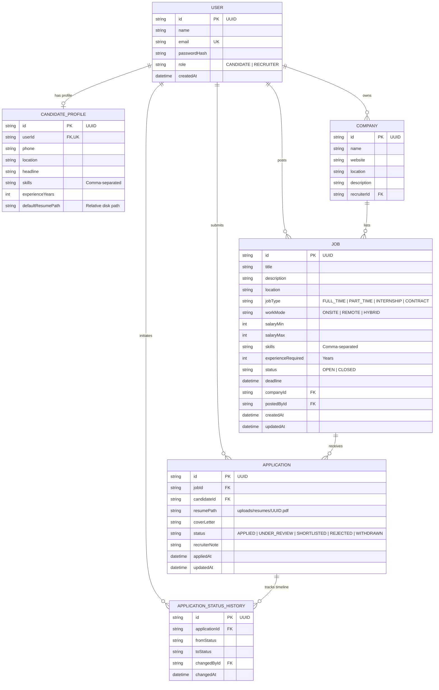

# HireLoop - Database Entity-Relationship (ER) Diagram

This diagram visualizes the data model defined in `server/prisma/schema.prisma`. Enums are managed at the application/Zod validation layer for portability between SQLite and PostgreSQL.

