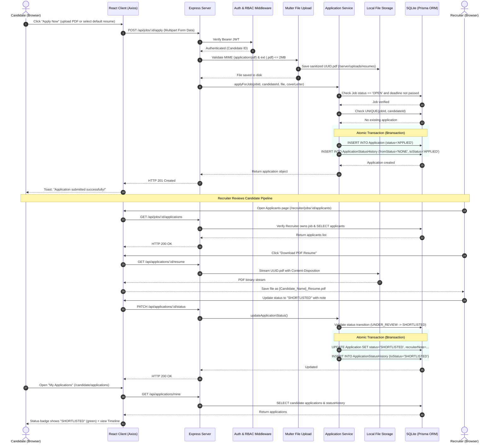

# Sequence Diagram: Candidate Applies for a Job

This sequence diagram illustrates the lifecycle of a job application in HireLoop, including file validation, atomic database persistence, recruiter review, and candidate real-time tracking.

